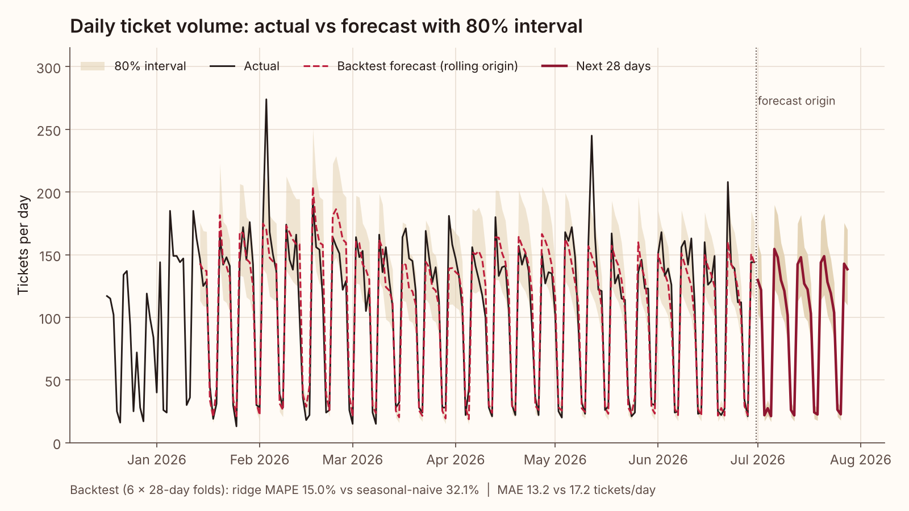
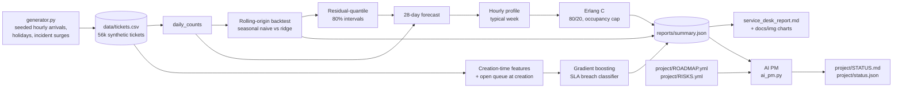
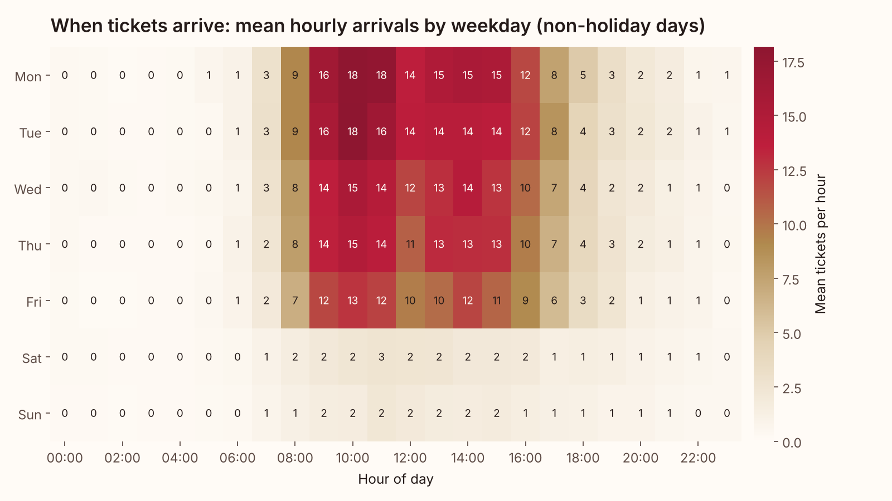
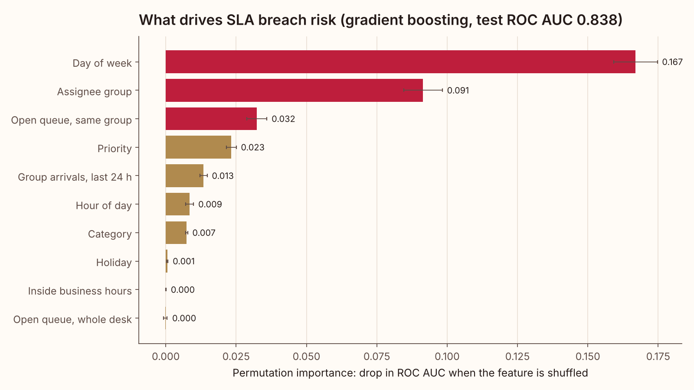
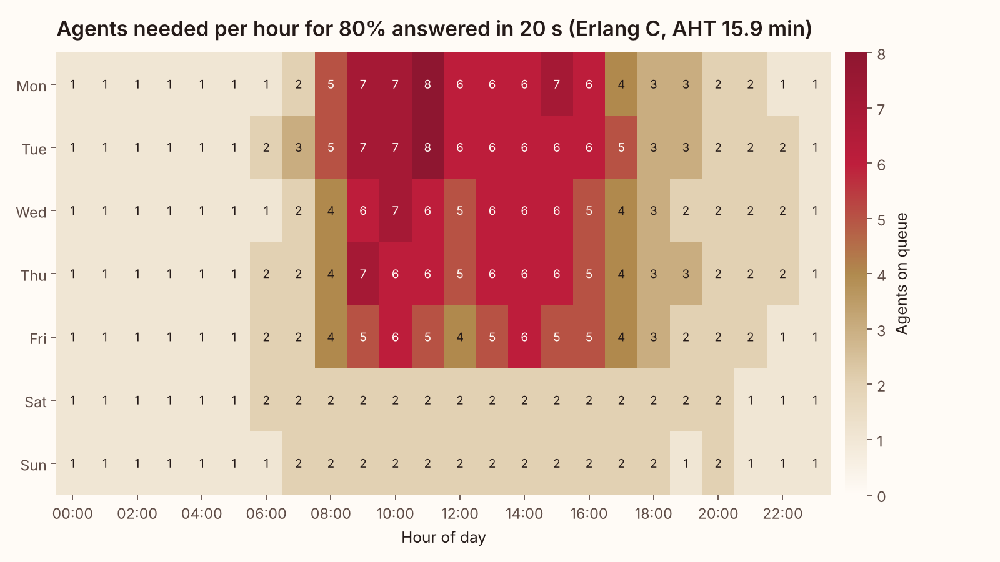

# Service Desk Forecast

**Forecast IT ticket demand, flag tickets likely to breach SLA when they are logged, and turn the forecast into an hourly staffing plan with Erlang C.**

[](https://github.com/laurenbmcguire/service-desk-forecast/actions/workflows/ci.yml)

[](LICENSE)
[](project/STATUS.md)



## Why it matters

- **Staffing is the biggest cost line on a service desk.** A forecast that misses holidays and Monday peaks leads straight to idle agents or long queues. A holiday-aware forecast with honest error bands lets you plan the roster weeks ahead.
- **SLA breaches can be predicted when the ticket is logged.** If you score risk at creation, a team lead can re-route or escalate the riskiest 10% of tickets before the clock runs out instead of explaining breaches afterwards.
- **One pipeline connects demand, risk and headcount.** The same forecast feeds an Erlang C model, so "how many agents do we need on Monday at 11:00" has a traceable answer.

## What it does

- **Synthetic ticket generator** (seeded): 18 months of hourly arrivals with weekday and hour-of-day seasonality, month seasonality, growth, company holidays, busy days after holidays, a quiet year-end week and five incident surges (email outage, VPN failure, SSO outage, phishing wave, office-suite regression). Resolution times depend on category, priority, who works the ticket, business-hours coverage, queue load and group capacity.
- **Demand forecasting:** seasonal-naive baseline vs a ridge regression on calendar features and holiday-robust 4 to 11 week lags. Rolling-origin backtest (6 folds x 28 days) with MAE and MAPE, and a 28-day forecast with prediction intervals from backtest residual quantiles.
- **SLA breach model:** gradient boosting (scikit-learn `HistGradientBoostingClassifier`) on fields known at creation plus open-queue length at creation. Time-based split; reports ROC AUC, precision at the top 10% and permutation importance, with ablations.
- **Staffing:** Erlang C turns forecast hourly arrivals and average handle time into agents per hour for an 80/20 service level with an 85% occupancy cap, then converts agent-hours into scheduled FTE.
- **Outputs:** `reports/service_desk_report.md`, `reports/summary.json`, CSVs for the forecast, backtest folds and staffing grid, and four charts in `docs/img/`.
- **AI Project Manager:** a weekly CI job reads the roadmap, the risk register and `summary.json` and writes [project/STATUS.md](project/STATUS.md).

## Architecture



## Results on the sample data

All numbers come from `python -m deskcast run` on the seeded synthetic data (546 days, 56,423 tickets, 2025-01-01 to 2026-06-30). Full detail is in [reports/service_desk_report.md](reports/service_desk_report.md).

| Area | Metric | Result |
|---|---|---|
| Forecast | Backtest MAPE, ridge vs seasonal naive (6 x 28-day folds) | **15.0%** vs 32.1% (53% lower) |
| Forecast | Backtest MAE, ridge vs seasonal naive | **13.2** vs 17.2 tickets/day (23% lower) |
| Forecast | 80% interval coverage, calibrated on folds 1-3, tested on folds 4-6 | 89.3% (conservative) |
| Forecast | Next 28 days (2026-07-01 to 2026-07-28) | 2,688 tickets, 80% band 2,130 to 3,306 |
| SLA risk | Test ROC AUC (Mar to Jun 2026, 12,837 tickets) | **0.838** (0.832 without queue features, 0.510 priority only) |
| SLA risk | Breach rate in the top 10% of predicted risk | **53.6%** vs 15.5% base rate (3.46x lift) |
| Staffing | Peak agents on queue for 80% in 20 s | **8** (Mon 11:00, 17.5 arrivals/hour, AHT 15.9 min) |
| Staffing | Typical week | 469 agent-hours, about 16.8 scheduled FTE at 30% shrinkage |

What stands out:

- **Day of week is the strongest breach driver.** P3/P4 work only happens in business hours, but SLA clocks run in calendar hours, so tickets logged on a Friday breach 32.1% of the time against 4.3% on a Monday. Priority on its own is close to useless (AUC 0.510).
- **The open queue in the assignee group at creation is the third most important feature.** In the generator, groups hit by a capacity dip or an incident surge build backlogs, and tickets that land in them run late; the model picks this up from the queue length alone.
- **Most of the forecast gain comes from holidays.** Seasonal naive forecasts a normal Monday on MLK Day and Presidents' Day. On the 8 holiday-related backtest days its MAPE is 281% vs 32.5% for the ridge model; on the other 160 days the gap is smaller (19.7% vs 14.1%, MAE 13.8 vs 12.9).

| Arrivals by weekday and hour | SLA breach drivers |
|---|---|
|  |  |



## AI Project Manager

`src/deskcast/ai_pm.py` manages this repo as a project. Every Monday the [AI PM workflow](.github/workflows/ai-pm.yml) re-runs the pipeline and then the PM, appends the status to the job summary and commits [project/STATUS.md](project/STATUS.md) and `project/status.json`.

The deterministic engine (always on, covered by tests):

- **Health RAG with a reason**, from explicit rules: RED for 2+ overdue milestones, an overdue milestone while a P0 item is open, or a risk scored 20+; AMBER for any overdue milestone, open P0 item or risk scored 15+; otherwise GREEN.
- **Milestone table** with % of linked backlog items done and days overdue.
- **Risk register** sorted by score (probability x impact) with a High / Medium / Low heat label.
- **Next 3 actions:** unblocked to-do items ranked by priority, then by satisfied dependencies.
- **What the data says:** 3-5 bullets read from `reports/summary.json`, so the status reflects what the analysis actually found.
- **Decision / change log** entry for the run.

Snippet of the committed status (as of 2026-11-02):

```text
## Overall health: **AMBER**

AMBER: 1 open P0 item(s) (B-10); 1 risk(s) scored >= 15 (R1=16).

## Next 3 actions

| # | ID | Action | Priority | Owner | Milestone |
|---|---|---|---|---|---|
| 1 | B-10 | Define ServiceNow incident-table field mapping onto the deskcast schema | P0 | Lauren | M6 |
| 2 | B-09 | Drift check that compares rolling MAPE with the backtest and flags a 30% gap | P1 | AI PM | M5 |
| 3 | B-11 | Timestamp data-quality checks for exports (time zones, resolved before created, bulk closures) | P1 | AI PM | M6 |

## What the data says

- Forecast: the calendar-feature ridge model beats seasonal naive by 53% on MAPE (15.0% vs 32.1%) and 23% on MAE across 6 rolling 28-day folds.
- SLA risk: ROC AUC 0.838; the top 10% riskiest tickets breach 54% of the time vs a 15% base rate (3.5x). Top driver: day of week.
- Staffing: peak of 8 agents (Mon 11:00) and 469 agent-hours in a typical week for 80%/20s, about 16.8 FTE after 30% shrinkage.
```

**LLM mode (optional).** If `ANTHROPIC_API_KEY` is set (the workflow passes it from an optional repository secret), the PM sends the computed facts JSON to the Anthropic Messages API with Python's standard-library `urllib` and asks for a 90-120 word executive summary grounded only in those facts. The model defaults to `claude-sonnet-4-5` and can be changed with `AI_PM_MODEL`. With no key, on any error, or if the reply is out of bounds, it falls back to a deterministic template summary, so the run never fails because of the LLM. Tests stub the HTTP call and never touch the network.

## Quickstart

```bash
git clone https://github.com/laurenbmcguire/service-desk-forecast.git
cd service-desk-forecast
pip install -e .
python -m deskcast run      # generates data/tickets.csv if missing, writes reports/ and docs/img/
python -m deskcast pm       # writes project/STATUS.md and project/status.json
pip install pytest && pytest -q
```

The full run takes about 10-20 seconds on a laptop and works offline. `python -m deskcast run --regenerate` rebuilds the synthetic data; `python -m deskcast pm --date 2026-11-02 --no-llm` reproduces the committed status exactly.

## Project structure

```text
service-desk-forecast/
├── src/deskcast/
│   ├── generator.py        # seeded synthetic tickets: arrivals, surges, resolution times
│   ├── calendar_utils.py   # company holidays, business-hour arithmetic
│   ├── forecast.py         # seasonal naive, calendar ridge, rolling-origin backtest, intervals
│   ├── sla.py              # creation-time features, queue length, breach classifier
│   ├── staffing.py         # Erlang B/C, service level, agents required
│   ├── charts.py           # matplotlib charts
│   ├── style.py            # shared brand style
│   ├── report.py           # Markdown report
│   ├── pipeline.py         # end-to-end run, summary.json
│   ├── ai_pm.py            # AI project manager
│   └── cli.py              # python -m deskcast run | pm | generate
├── tests/                  # 17 pytest tests
├── data/                   # sample_tickets.csv (1,000 rows), daily_volume.csv
├── docs/img/               # charts produced by the pipeline
├── reports/                # service_desk_report.md, summary.json, CSV outputs
├── project/                # ROADMAP.yml, RISKS.yml, STATUS.md, status.json
└── .github/workflows/      # ci.yml, ai-pm.yml
```

## Methodology

**Forecast.** Daily counts $y_t$. The baseline is seasonal naive, $\hat y_{T+h} = y_{T+h-7\lceil h/7\rceil}$. The model is ridge regression ($\alpha = 10$, standardized features) on $\log(1+y_t)$ with day-of-week and month indicators, holiday, day-after-holiday and year-end flags, a linear trend, the median of the same weekday 4 to 11 weeks back, and a 56-day level ending 28 days back. Holidays, bridge days and the year-end week are masked before the lags are taken. Every lag is at least 28 days old, so one fit forecasts all 28 days directly. The backtest uses 6 non-overlapping 28-day windows ending at the last observation, refitting at each origin.

$$\mathrm{MAE} = \tfrac{1}{n}\sum |y_t - \hat y_t| \qquad \mathrm{MAPE} = \tfrac{100}{n}\sum \frac{|y_t - \hat y_t|}{y_t}$$

**Intervals.** Backtest residuals $r_t = \log(1+y_t) - \log(1+\hat y_t)$; the 80% interval is $\exp(\log(1+\hat y) + q_{0.10}(r)) - 1$ to $\exp(\log(1+\hat y) + q_{0.90}(r)) - 1$. Holdout coverage is measured by calibrating on folds 1-3 and scoring folds 4-6.

**SLA labels.** Targets are calendar hours from creation to final resolution: P1 4 h, P2 8 h, P3 72 h, P4 120 h. Tickets still open at the extract are labelled breached only if they are already past target, otherwise they are excluded. Train: 2025-01-15 to 2026-02-28 (the first 14 days are skipped while the queue warms up); test: 2026-03-01 to 2026-06-30.

**SLA features** (all known at creation): category, priority, channel, assignee group, hour, weekday, business-hours and holiday flags, open tickets in the group and in the whole desk at creation ($\#\{\text{created} < t\} - \#\{\text{resolved} < t\}$), and group arrivals in the previous 24 hours. Importance is permutation importance on test ROC AUC (5 repeats, 8,000 test tickets).

**Erlang C.** With arrival rate $\lambda$ per hour and handle time AHT, the offered load is $A = \lambda\,\mathrm{AHT}$. The probability of waiting with $N$ agents is

$$P_W = \frac{\frac{A^N}{N!}\frac{N}{N-A}}{\sum_{k=0}^{N-1}\frac{A^k}{k!} + \frac{A^N}{N!}\frac{N}{N-A}}, \qquad \mathrm{SL}(t) = 1 - P_W\, e^{-(N-A)\,t/\mathrm{AHT}}$$

computed through the stable Erlang B recursion. Agents per hour is the smallest $N$ with $\mathrm{SL}(20\,\mathrm{s}) \ge 80\%$ and occupancy $A/N \le 85\%$ (minimum 1 for 24x7 cover). Hourly arrivals for a typical week are the mean non-holiday daily forecast per weekday times the last 12 weeks' hour-of-day share. AHT is the mean handle time over those 12 weeks. Applying the phone-style 80/20 target to every channel is conservative for portal and email tickets (risk R5).

## Data

**All data in this repository is synthetic.** It is produced by the seeded generator in `src/deskcast/generator.py` (seed 42) and contains no real tickets, people, organizations or systems. The committed `data/` folder holds a 1,000-row sample and the daily series; the full 56,423-row file is regenerated on demand. The results above describe how the methods behave on this synthetic data, not the performance of any real service desk.

## Roadmap

From [project/ROADMAP.yml](project/ROADMAP.yml):

| ID | Milestone | Due | Status |
|---|---|---|---|
| M1 | Synthetic ticket generator | 2026-09-18 | done |
| M2 | Forecast backtest | 2026-10-02 | done |
| M3 | SLA breach model | 2026-10-16 | done |
| M4 | Staffing model | 2026-10-30 | done |
| M5 | Interval calibration and drift monitoring | 2026-11-20 | in progress |
| M6 | ServiceNow / Jira export connector | 2026-12-18 | planned |
| M7 | Power BI dashboard | 2027-01-29 | planned |

Key risks tracked in [project/RISKS.yml](project/RISKS.yml): concept drift, holiday effects, timestamp data quality, incident surges, Erlang C assumptions, the synthetic-to-real gap and label leakage.

## Author

**Lauren McGuire**, AI & Cloud Architect
[laurenmcguireresume.com](https://laurenmcguireresume.com) · [LinkedIn](https://www.linkedin.com/in/laurenbmcguire)
