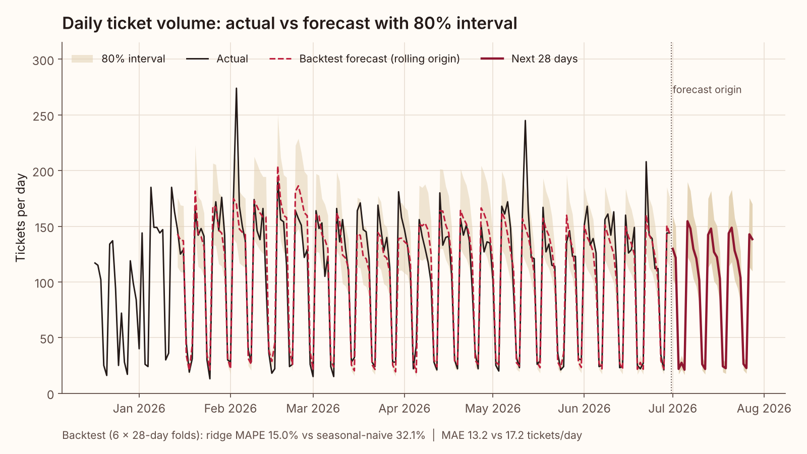
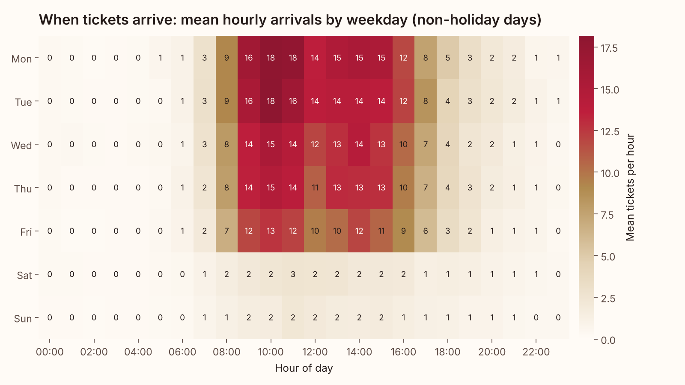
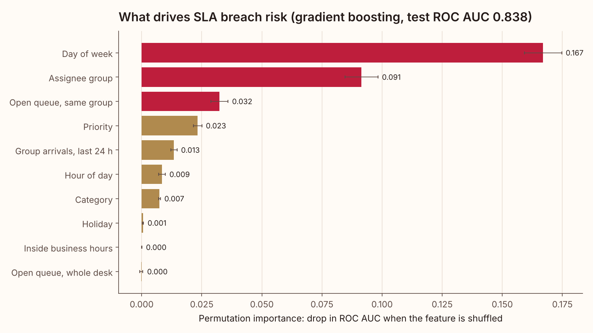
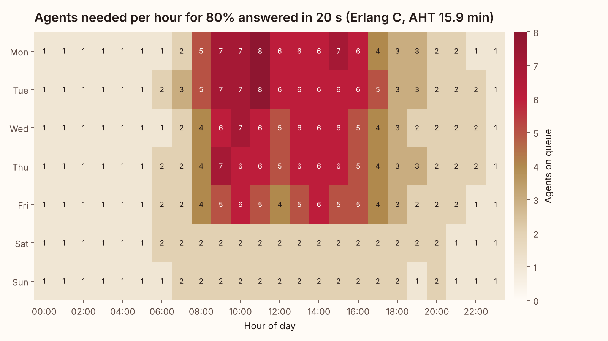

# Service Desk Forecast report

Synthetic IT service desk data, 2025-01-01 to 2026-06-30 (546 days, 56,423 tickets). All numbers below are computed by `python -m deskcast run` on data from the seeded generator in this repo.

## Headline

- **Forecast:** the calendar-feature ridge model cuts MAPE from 32.1% to 15.0% (53% better) and MAE from 17.2 to 13.2 tickets/day (23% better) versus seasonal naive, over 6 rolling 28-day folds.
- **Next 28 days (2026-07-01 to 2026-07-28):** 2,688 tickets forecast (80% band 2,130 to 3,306, summing daily bounds).
- **SLA risk:** test ROC AUC 0.838; the riskiest 10% of new tickets breach 53.6% of the time against a 15.5% base rate (3.5x lift).
- **Staffing:** 469 on-queue agent-hours in a typical week, peaking at 8 agents (Mon 11:00); about 16.8 scheduled FTE at 30% shrinkage.

## Data

| Metric | Value |
|---|---|
| Tickets | 56,423 |
| Mean tickets per weekday / weekend day | 134.5 / 25.5 |
| SLA breach rate (labelled tickets) | 16.7% |
| Reopen rate | 5.1% |
| Median resolution time | 20.99 h |
| Open at extract (censored) | 158 |
| Resolved before created | 0 |
| Duplicate ticket IDs | 0 |

Injected incident surges and the volume they produced:

| Date | Incident | Category | Tickets that day | x weekday mean |
|---|---|---|---|---|
| 2025-03-11 | Email outage: inbound mail flow stopped | email | 319 | 2.08 |
| 2025-06-17 | VPN gateway failure | network | 247 | 1.61 |
| 2025-10-07 | SSO / MFA provider outage | access | 305 | 1.99 |
| 2026-02-03 | Phishing campaign wave | security | 274 | 1.79 |
| 2026-05-12 | Office suite update regression | software | 245 | 1.60 |

## Forecast backtest

Rolling origin, 6 folds, 28-day horizon, model re-fit at every origin.

| Fold | Test window | Ridge MAE | Ridge MAPE | Naive MAE | Naive MAPE |
|---|---|---|---|---|---|
| 1 | 2026-01-14 to 2026-02-10 | 12.5 | 13.1% | 20.1 | 38.0% |
| 2 | 2026-02-11 to 2026-03-10 | 17.0 | 25.0% | 20.8 | 48.9% |
| 3 | 2026-03-11 to 2026-04-07 | 13.2 | 14.1% | 14.1 | 17.1% |
| 4 | 2026-04-08 to 2026-05-05 | 12.0 | 13.1% | 10.8 | 23.1% |
| 5 | 2026-05-06 to 2026-06-02 | 14.2 | 14.0% | 20.2 | 35.9% |
| 6 | 2026-06-03 to 2026-06-30 | 10.3 | 10.8% | 17.3 | 29.8% |
| **All** |  | **13.2** | **15.0%** | **17.2** | **32.1%** |

Split by day type (special days = holidays, the business day after a holiday, and Dec 24-31 weekdays):

| Day type | Days | Ridge MAE | Ridge MAPE | Naive MAE | Naive MAPE |
|---|---|---|---|---|---|
| special days | 8 | 18.5 | 32.5% | 85.0 | 281.4% |
| normal days | 160 | 12.9 | 14.1% | 13.8 | 19.7% |

Prediction intervals use the 80% quantiles of backtest log residuals (-0.230, +0.205). Calibrating on the first half of the folds and testing on the second half gives 89.3% coverage.

## 28-day forecast by week

| Week | Dates | Forecast | 80% band | Seasonal naive | Holidays |
|---|---|---|---|---|---|
| 1 | 2026-07-01 to 2026-07-07 | 625 | 495 to 768 | 706 | Independence Day |
| 2 | 2026-07-08 to 2026-07-14 | 691 | 547 to 849 | 706 | - |
| 3 | 2026-07-15 to 2026-07-21 | 691 | 548 to 850 | 706 | - |
| 4 | 2026-07-22 to 2026-07-28 | 681 | 540 to 838 | 706 | - |

## SLA breach model

Targets (hours, creation to resolution): P1 4, P2 8, P3 72, P4 120. Train 2025-01-15 to before 2026-03-01 (42,069 tickets), test 2026-03-01 to 2026-06-30 (12,837 tickets). Features are limited to what is known when the ticket is logged.

| Metric | Value |
|---|---|
| ROC AUC (gradient boosting) | 0.838 |
| ROC AUC without queue features | 0.832 |
| ROC AUC, priority-only rule | 0.510 |
| Test breach rate | 15.5% |
| Precision at top 10% risk | 53.6% |
| Lift at top 10% | 3.46x |

Permutation importance (drop in test ROC AUC when the feature is shuffled):

| Feature | Importance | Std |
|---|---|---|
| dow | 0.1670 | 0.0077 |
| assignee_group | 0.0915 | 0.0068 |
| queue_open_group | 0.0324 | 0.0035 |
| priority | 0.0233 | 0.0018 |
| arrivals_prev_24h_group | 0.0134 | 0.0013 |
| hour | 0.0085 | 0.0014 |
| category | 0.0074 | 0.0003 |
| is_holiday | 0.0005 | 0.0002 |
| is_business_hours | 0.0000 | 0.0001 |
| queue_open_total | -0.0002 | 0.0006 |
| channel | -0.0004 | 0.0001 |

Breach rate by weekday of creation (all labelled tickets). P3/P4 work only accrues in business hours while SLA clocks run in calendar hours, so tickets logged late in the week carry the weekend:

| Mon | Tue | Wed | Thu | Fri | Sat | Sun |
|---|---|---|---|---|---|---|
| 4.3% | 9.9% | 17.0% | 26.4% | 32.1% | 21.9% | 5.1% |

Breach rate by assignee group:

| Group | Breach rate |
|---|---|
| Service Desk L1 | 3.1% |
| Identity & Access | 9.4% |
| Messaging | 16.8% |
| Network Ops | 20.2% |
| Security Ops | 25.5% |
| Application Support | 26.6% |
| End-User Computing | 34.9% |

Test-period breach rate by priority:

| Priority | Tickets | Breach rate | Mean predicted risk |
|---|---|---|---|
| P1 | 300 | 13.0% | 13.1% |
| P2 | 1351 | 16.1% | 18.2% |
| P3 | 6576 | 15.8% | 15.9% |
| P4 | 4610 | 15.0% | 15.3% |

## Staffing (Erlang C)

Typical week built from the non-holiday days of the 28-day forecast and the last 12 weeks' hourly profile. AHT 15.92 min, target 80% answered within 20 s, occupancy cap 85%, minimum 1 agent per hour.

| Day | Forecast tickets | Peak agents | Agent-hours | First peak hour |
|---|---|---|---|---|
| Mon | 146 | 8 | 83 | 11:00 |
| Tue | 146 | 8 | 86 | 11:00 |
| Wed | 129 | 7 | 76 | 10:00 |
| Thu | 121 | 7 | 78 | 09:00 |
| Fri | 103 | 6 | 70 | 10:00 |
| Sat | 26 | 2 | 39 | 06:00 |
| Sun | 22 | 2 | 37 | 07:00 |

Total 469 on-queue agent-hours per week; with 30% shrinkage that is about 16.8 scheduled FTE at 40 h/week.

## Charts

